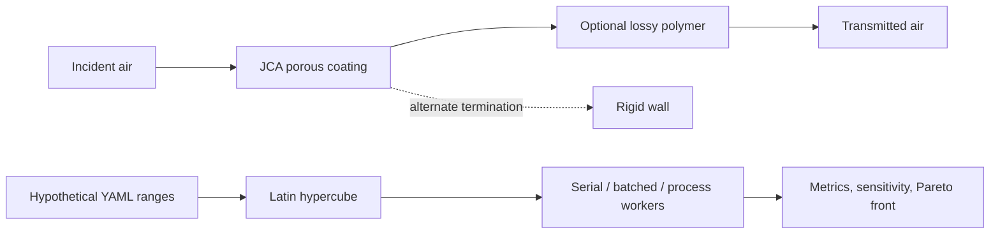

# acoustic_coating_hpc

`acoustic_coating_hpc` is a compact computational-acoustics research project for exploring a **hypothetical mineral-filled polymer coating** at normal incidence. It combines a Johnson–Champoux–Allard (JCA) rigid-frame equivalent fluid, a deliberately simplified lossy longitudinal polymer model, a one-dimensional transfer-matrix method (TMM), Latin-hypercube design exploration, and honest serial/vectorized/process-parallel timing.

This is a theoretical study using synthetic, representative parameters. It contains **no proprietary or experimental Imerys data**, and no parameter set is asserted to describe a commercial material. Mineral type, particle morphology, loading, dispersion, binder content, and processing may influence effective porous and mechanical properties, but the project does not infer JCA parameters directly from mineral chemistry.

## Physics and architecture



All calculations use SI units and the harmonic convention

$$e^{j\omega t},\qquad \omega=2\pi f.$$

A wave traveling in the positive $x$ direction is $p^+e^{-jkx}$. Therefore a passive medium has $\operatorname{Im}(k)\le 0$, so that $e^{-jkx}$ decays. Square-root signs are selected as a coupled impedance/wavenumber pair to enforce this condition without breaking $k=\omega\rho/Z$.

### Ambient air

The defaults represent room-temperature air: $\rho_0=1.2041$ kg/m³, $c_0=343.2$ m/s, $\eta=1.825\times10^{-5}$ Pa·s, $P_0=101325$ Pa, $\gamma=1.4$, $\kappa=0.0257$ W/(m·K), and $C_p=1005$ J/(kg·K). The characteristic impedance is $Z_0=\rho_0c_0$.

### JCA porous coating

The coating is a rigid-frame equivalent fluid characterized by open porosity $\phi$, airflow resistivity $\sigma$, high-frequency tortuosity $\alpha_\infty$, viscous length $\Lambda$, thermal length $\Lambda'$, and thickness $d$.

$$
\widetilde\rho=\frac{\alpha_\infty\rho_0}{\phi}\left[1+\frac{\sigma\phi}{j\omega\rho_0\alpha_\infty}
\sqrt{1+j\frac{4\alpha_\infty^2\eta\rho_0\omega}{\sigma^2\Lambda^2\phi^2}}\right]
$$

and

$$
\widetilde K=\frac{\gamma P_0/\phi}{\gamma-(\gamma-1)\left[1-j\frac{8\kappa}{\Lambda'^2C_p\rho_0\omega}
\sqrt{1+j\frac{\Lambda'^2C_p\rho_0\omega}{16\kappa}}\right]^{-1}}.
$$

Then $Z_c=\sqrt{\widetilde\rho\widetilde K}$ and $k_c=\omega\sqrt{\widetilde\rho/\widetilde K}$. The density term represents viscous inertia and drag in pores; the bulk-modulus term represents thermal exchange between the pore fluid and frame surfaces.

### Viscoelastic backing

The backing uses an effective longitudinal modulus

$$M^*=M'(1+j\eta_L),\quad c_L^*=\sqrt{M^*/\rho_s},\quad Z_L=\sqrt{\rho_sM^*},\quad k_L=\omega\sqrt{\rho_s/M^*}.$$

This is an effective 1D wave model, not a full three-dimensional structural-acoustic treatment. It is useful for examining how mechanical damping interacts with porous loss and thickness resonances.

### Transfer matrices and observables

For the stated convention, a homogeneous layer maps the right-face state to the left-face state as

$$
\begin{bmatrix}p_L\\u_L\end{bmatrix}=
\begin{bmatrix}
\cos(kd)&jZ\sin(kd)\\
j\sin(kd)/Z&\cos(kd)
\end{bmatrix}
\begin{bmatrix}p_R\\u_R\end{bmatrix}.
$$

Matrices are multiplied in physical left-to-right layer order. At a rigid termination $u_R=0$, hence $Z_s=A/C$, $R=(Z_s-Z_0)/(Z_s+Z_0)$, and $\alpha=1-|R|^2$.

For a stack matrix $\mathbf T=\begin{bmatrix}A&B\\C&D\end{bmatrix}$ between identical air half-spaces, write $p_L=p_i+p_r$, $u_L=(p_i-p_r)/Z_0$, $p_R=p_t$, and $u_R=p_t/Z_0$. Substitution and elimination give

$$
t_p=\frac{p_t}{p_i}=\frac{2}{A+B/Z_0+CZ_0+D},
$$

$$
r=\frac{A+B/Z_0-CZ_0-D}{A+B/Z_0+CZ_0+D}.
$$

Because the incident and transmitted media are identical, $\tau=|t_p|^2$ and $TL=-10\log_{10}\tau$. Dissipated fraction is $1-|r|^2-\tau$. Only roundoff-scale excursions are clipped.

## Installation and use

From this directory:

```bash
python -m venv .venv
source .venv/bin/activate             # Windows PowerShell: .venv\Scripts\Activate.ps1
python -m pip install -e ".[dev]"
pytest
```

Generate the baseline porous spectrum, porous-plus-polymer spectrum, JCA diagnostics, parameter comparisons, and validation report:

```bash
python scripts/run_single_case.py
```

Run the reproducible 10,000-case design sweep (the allowed range is 1,000–100,000):

```bash
python scripts/run_parameter_study.py --cases 10000 --mode batched
# or: --mode serial
# or: --mode parallel --workers 4
```

Analyze sensitivity, rank designs, and construct the mass/performance Pareto front:

```bash
python scripts/analyze_design_space.py
```

Benchmark actual work, including multiprocessing overhead:

```bash
python scripts/run_hpc_benchmark.py --sizes 100 1000 10000 --workers 4
# Add 100000 only if runtime and memory are appropriate for the machine.
```

CSV outputs go to `results/data/`; PNG figures go to `results/figures/`. Parquet output is supported when `pyarrow` is installed by passing a `.parquet` output path. The notebooks are short, editable entry points rather than duplicated implementations.

## Design space and HPC strategy

All hypothetical bounds and the random seed are centralized in [`design_space.yaml`](design_space.yaml). A scrambled `scipy.stats.qmc.LatinHypercube` covers the effective-property space without pretending that independent bounds encode a manufacturable formulation. The outputs include band-integrated rigid-backed absorption, peak absorption and frequency, mean/minimum air-backed multilayer TL, a transparent combined score, areal mass, and mass-normalized score.

Three execution modes share the same equations:

- `serial`: readable case-by-case reference.
- `batched`: true NumPy arrays over cases × frequencies, bounded by `--batch-size`.
- `parallel`: independent batched chunks evaluated with `ProcessPoolExecutor`.

Process startup and data-transfer overhead can make parallel execution slower for small studies; benchmark tables report that outcome rather than hiding it. Sensitivity analysis uses Spearman rank correlations and standardized multivariate linear coefficients. These are descriptive screening tools, not causal or composition-level models.

## Verification

The tests and `validation.json` establish:

- finite, vectorized JCA properties and the passive branch $\operatorname{Im}(k)\le0$;
- bounded rigid-backed absorption for the representative $\phi=0.95$, $\sigma=20000$ Pa·s/m², $\alpha_\infty=1$, $\Lambda=80$ µm, $\Lambda'=200$ µm, $d=15$ mm case;
- vanishing absorption as a rigid-backed coating becomes extremely thin;
- convergence of band-average response as frequency resolution increases;
- unit transmission and zero reflection for a lossless air layer;
- no power gain and closed power balance for passive air-backed multilayers;
- numerical agreement between serial and case-batched solvers.

Mechanical loss-factor comparisons are plotted directly. Their physical interpretation should be made resonance by resonance: added loss generally lowers and broadens sharp features, but it need not monotonically increase TL at every frequency.

## Reproduced demonstration results

On the checked-in 100–5000 Hz grids, the 15 mm representative rigid-backed JCA layer has absorption from 0.0072 to 0.8595. Its 0.1 µm thin-layer check has maximum absorption $2.1\times10^{-6}$, and the final frequency-grid refinement changes band-average absorption by $2.53\times10^{-5}$. The passive multilayer closes its power balance to $1.11\times10^{-16}$. For an intentionally soft/thick polymer example with in-band longitudinal structure, raising $\eta_L$ from 0.02 to 0.30 reduces total spectral variation from 75.36 to 34.80 dB, demonstrating damping-induced smoothing.

In the fixed-seed 10,000-case sweep, the top combined-score design reaches 1.8248 (mean absorption 0.8834, mean TL 47.07 dB, areal mass 18.21 kg/m²). This is a synthetic optimum within the configured box, not a recommended formulation. Spearman screening finds coating thickness dominant for mean absorption ($\rho_s=0.920$), polymer thickness dominant for mean TL ($\rho_s=0.854$), and coating bulk density strongly detrimental to mass-normalized score ($\rho_s=-0.856$).

The included machine-specific four-worker benchmark gives serial/batched/process times of approximately 5.76/1.63/3.44 s at 10,000 cases. Thus case batching is 3.54× faster than the serial reference; four processes are 1.67× faster than serial but slower than the single-process batched path. At 100 and 1,000 cases, process startup dominates and multiprocessing is substantially slower. These timings should be regenerated on each target machine.

## Assumptions and limitations

- Plane waves, normal incidence, laterally infinite layers, linear time-harmonic behavior.
- Rigid porous frame; no frame-borne wave, limp-frame coupling, or Biot slow/fast waves.
- Homogeneous, isotropic effective parameters; no particle-scale scattering or gradients.
- Constant polymer loss factor and a scalar longitudinal modulus.
- Perfectly bonded interfaces and no interfacial compliance.
- Synthetic independent parameter bounds may include combinations that would be hard to manufacture.
- No experimental calibration, uncertainty model, or commercial-material identification.

Logical next steps are impedance-tube validation with measured airflow resistivity/porosity/characteristic lengths, uncertainty propagation, frequency-dependent polymer rheology, then full Biot poroelasticity and finite-element structural-acoustic models where frame motion, shear, geometry, and oblique incidence matter.

